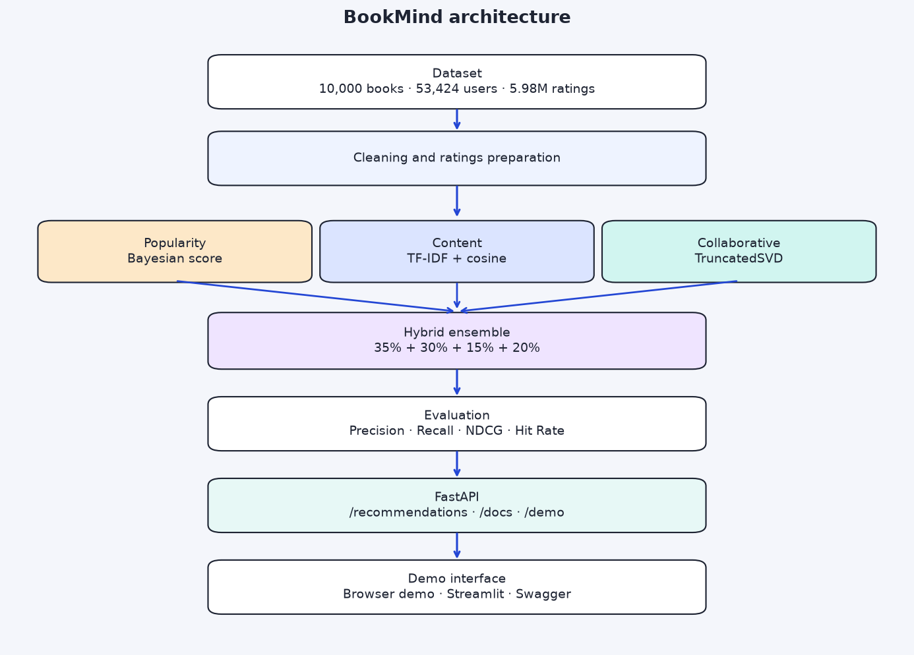

# BookMind

**An intelligent book recommendation system built with Python, FastAPI, and four ML models.**

BookMind demonstrates how a complete recommender pipeline works — from raw data cleaning and feature extraction through model training, evaluation, a REST API, and a live demo interface.

---

## What it does

| Model | Input | Signal | Use Case |
|---|---|---|---|
| Popularity | — | Rating volume + average | Cold-start / trending books |
| Content-Based | Book ID | TF-IDF metadata similarity | "More like this" |
| Collaborative | User ID | SVD latent factors | Personalized recommendations |
| Hybrid | User ID | 35% Collaborative + 30% Content + 15% Readability + 20% Popularity | Best overall accuracy |

## Dataset

- **10,000 books** · **53,424 users** · **5,976,479 ratings**
- Source: Goodreads-style public dataset (see [docs/DATASET.md](docs/DATASET.md))

## Key features

- Popularity baseline with Bayesian weighted scoring
- Content-based recommendations using TF-IDF + cosine NearestNeighbors
- Collaborative filtering with TruncatedSVD latent factors
- Hybrid ensemble with configurable per-component weights
- FastAPI backend with full Swagger/OpenAPI UI at `/docs`
- Interactive browser demo (no Node.js required)
- Streamlit training dashboard with live pipeline logs
- Evaluation metrics: Precision@10, Recall@10, NDCG@10, Hit Rate@10
- Author diversity enforcement in all recommendation outputs
- Graceful cold-start fallback to popularity for unknown users

## Documentation

| File | Contents |
|---|---|
| [docs/DEMO.md](docs/DEMO.md) | Step-by-step demo guide |
| [docs/API.md](docs/API.md) | API endpoint reference |
| [docs/MODELS.md](docs/MODELS.md) | Model explanations |
| [docs/EVALUATION.md](docs/EVALUATION.md) | Metrics and results |
| [docs/ARCHITECTURE.md](docs/ARCHITECTURE.md) | System architecture |
| [docs/DATASET.md](docs/DATASET.md) | Dataset details and attribution |

## Project structure

```text
bookmind/
├── api/          FastAPI backend
├── data/         Processed datasets
├── demo/         Static HTML/CSS/JS demo interface
├── docs/         All project documentation
├── models/       Trained model pickle files
├── reports/      Evaluation charts and graphs
├── src/          ML model source code
├── tests/        Pytest test suite
├── app.py        Streamlit dashboard
├── .gitignore
├── LICENSE
├── README.md
└── requirements.txt
```

## Quick start

### 1. Create and activate a virtual environment

```bash
python -m venv .venv
# Windows
.venv\Scripts\activate
# Linux/macOS
source .venv/bin/activate
```

### 2. Install dependencies

```bash
pip install -r requirements.txt
```

> **Python 3.10–3.13 recommended.**

### 3. Train the models

The trained model files are included in `models/`. If you want to retrain from scratch:

```bash
python src/train_all.py
```

This runs all 8 pipeline stages: data cleaning → ratings prep → popularity → content → collaborative → hybrid → evaluation → report graphs.

### 4. Start the API server

```bash
python -m uvicorn api.main:app --host 127.0.0.1 --port 8000 --reload
```

Swagger UI will be available at: **http://127.0.0.1:8000/docs**

### 5a. Open the browser demo

Open `demo/index.html` directly in a browser while the API is running.

### 5b. Or start the Streamlit dashboard

```bash
streamlit run app.py
```

## Models

See [docs/MODELS.md](docs/MODELS.md) for full per-model documentation.

| Model | Algorithm | Key parameter |
|---|---|---|
| Popularity | Bayesian weighted score | min 8 ratings threshold |
| Content-Based | TF-IDF + NearestNeighbors (cosine) | 50,000 vocab, n_neighbors=50 |
| Collaborative | TruncatedSVD | 50 latent components |
| Hybrid | Weighted combination | 35% + 30% + 15% + 20% |

## Evaluation

Evaluation metrics are reported in [docs/EVALUATION.md](docs/EVALUATION.md) and stored in [data/processed/evaluation_results.csv](data/processed/evaluation_results.csv).

The evaluation uses a per-user holdout (last rated item) strategy to avoid data leakage. The metrics reflect honest performance on a sparse dataset with no inflation.

## Architecture



See [docs/ARCHITECTURE.md](docs/ARCHITECTURE.md) for pipeline details.

## Testing

```bash
pytest
```

15 tests covering model behavior, API endpoints, data validation, cold-start, and recommendation output.

## Limitations

- Collaborative recommendations depend on the density of user interaction data.
- Cold-start users (not in training) receive popularity-based fallback.
- The evaluation metrics are low — this is honest and expected for a sparse academic dataset.
- Recommendation quality is limited by metadata completeness in the source dataset.

## License

MIT License. See [LICENSE](LICENSE).

> **Note**: The source dataset is the Goodbooks-10k Goodreads-style public dataset. See [docs/DATASET.md](docs/DATASET.md) for attribution details.
